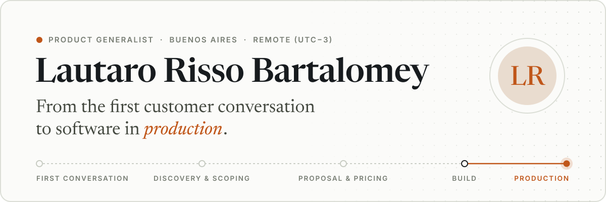
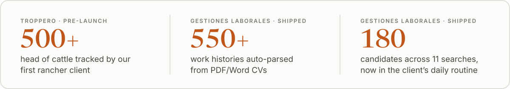

<picture>
  <source media="(prefers-color-scheme: dark)" srcset="assets/banner-dark.svg">
  
</picture>

  &nbsp;
  &nbsp;
  

**Product generalist who builds.** I take work from the first customer conversation to software in production — and I run the commercial side that gets it sold. When something needs to exist, I build it myself with AI-assisted development (Claude Code, Cursor). I'm at my best where the role isn't fully defined yet.

📍 Buenos Aires · remote (UTC−3) · open to relocation &nbsp;·&nbsp; English C1/C2 · Spanish native · Italian basic

 

## Now building

<table>
<tr>
<td width="50%" valign="top">

### Troppero &nbsp;
<b>CO-FOUNDER · PRODUCT &amp; ENGINEERING</b> &nbsp;·&nbsp; Sep 2026 – present &nbsp;·&nbsp; <a href="https://troppero.com">troppero.com&nbsp;↗</a>

Livestock-management software for Argentine ranchers, about to launch. I own product and go-to-market, and I build it hands-on.

- Offline-first PWA for fields with no signal
- Satellite paddock maps
- Multi-tenant Supabase backend
- AI receipt extraction from a photo

</td>
<td width="50%" valign="top">

### Orka Studio &nbsp;
<b>CO-FOUNDER · PRODUCT &amp; COMMERCIAL</b> &nbsp;·&nbsp; Mar 2026 – present

A two-person software studio, with a technical co-founder. I run the full client cycle — prospecting, discovery, scoping, proposals, delivery — and I build.

- **Gestiones Laborales** — AI recruiting platform for an HR consultancy
- **Hormimonte** — remote monitoring for a concrete plant
- **orka-brain** — governed knowledge base + AI-agent skills

</td>
</tr>
</table>

<picture>
  <source media="(prefers-color-scheme: dark)" srcset="assets/metrics-dark.svg">
  
</picture>

### Selected work at Orka

<table>
<tr>
<td width="33%" valign="top">

**Gestiones Laborales** 

AI recruiting platform for an HR consultancy. An LLM pipeline parses PDF/Word CVs — 180 candidates, 11 searches, 550+ work histories auto-parsed. Now part of the client's daily routine.

Next.js · Vercel AI SDK · Claude

</td>
<td width="33%" valign="top">

**Hormimonte** 

Remote monitoring for a concrete plant: read-only PLC/HMI over Modbus TCP, through Node-RED into a web app, so the owner can read every batch from 180 km away.

Modbus TCP · Node-RED · web app

</td>
<td width="33%" valign="top">

**orka-brain** 

A governed knowledge base and custom AI-agent skills — planning, code review, QA, retrospectives — with a memory layer, so agents can pick up real client work with context.

AI agents · memory layer

</td>
</tr>
</table>

## Previously

<table>
<tr>
<td width="24%" valign="top"><b>Ágora</b> Jul 2025 – Jul 2026</td>
<td valign="top"><b>Growth &amp; Activation, core team</b> · early-stage B2B SaaS (booking &amp; scheduling) Owned activation and retention. Shipped a three-channel churn-recovery system (Intercom, email, WhatsApp Business) and built an internal Slack-triggered AI agent that queried Amplitude to surface onboarding drop-offs.</td>
</tr>
<tr>
<td valign="top"><b>Globant</b> Dec 2024 – Mar 2025</td>
<td valign="top"><b>Product Manager Trainee</b> · U.S. enterprise engagement Product discovery and requirements, in English, across design, engineering and product teams.</td>
</tr>
<tr>
<td valign="top"><b>Sisu</b> in discovery</td>
<td valign="top"><b>Business side</b> · an AI staff engineer for startup meetings ICP, positioning, pricing, and discovery interviews with CTOs across LATAM.</td>
</tr>
</table>

## Toolkit

**Product** 
Discovery & user interviews · scoping · roadmap prioritization · activation / retention / churn · onboarding · pricing & go-to-market

**Building with AI** 

**Engineering** 
<picture><source media="(prefers-color-scheme: dark)" srcset="https://skillicons.dev/icons?i=ts%2Creact%2Cnextjs%2Cvite%2Ctailwind%2Csupabase%2Cgithubactions%2Cvitest%2Cvercel&theme=dark&perline=9"></picture> 

<b>Education</b>

 

- **B.S. in Digital Business** — UCEMA (2021–2025)
- **Exchange** — Sapienza Università di Roma (2024)
- **Dock Startup Lab Accelerator** — Rome (2024)

 

Building something where the role isn't fully defined yet? <a href="mailto:lautirissob@gmail.com">Let's talk</a>.

